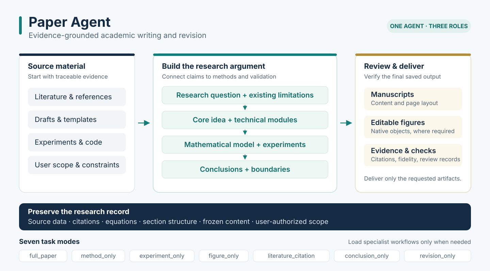
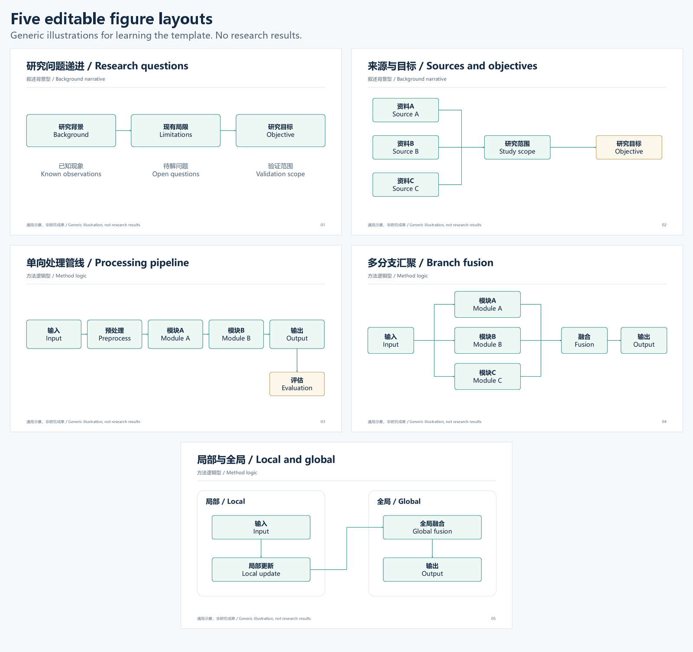
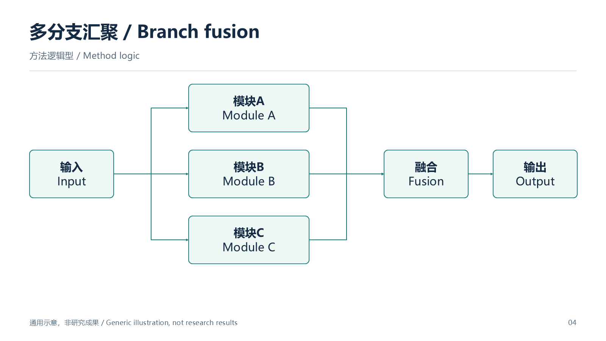
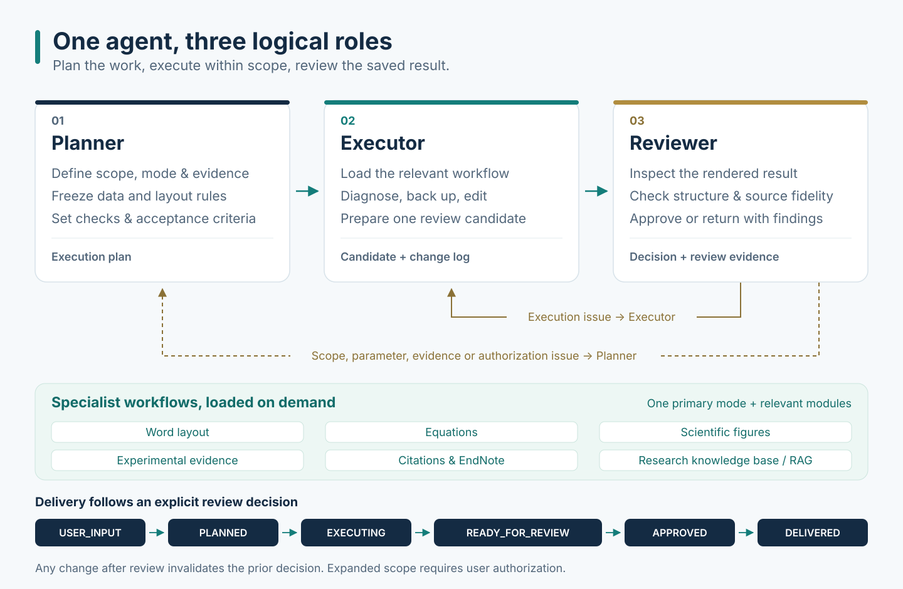

# Paper Agent

**简体中文** | [English](README.en.md)

面向科研论文与学位论文的 Codex skill。把资料、研究问题、方法、实验和结论组织成可核对的证据链，按 **规划 → 执行 → 审查** 完成写作、修订、引用与版式处理。

可以处理整篇论文，也可以只改一个小节、一张表或一页科研图。已有正文、实验数据、公式、引文字段和用户指定的冻结内容会进入保真检查；Word 与 PowerPoint 的交付还要求检查实际渲染结果。



## 从这里开始

1. **安装 skill**：将本仓库完整放入 Codex 能发现的 `paper-agent` 技能目录。
2. **建立独立论文项目**：原稿、文献、数据和格式要求放在自己的私有工作目录中。
3. **在对话中调用**：输入 `$paper-agent`，写明目标文件、修改范围、保留内容和输出位置。
4. **补齐当前任务必要信息**：例如缺失的实验依据、参考图用途、目标 PPT 页面，或 EndNote 文库范围。
5. **取得成果**：交付所需文件及检查说明，中间文件留在 `build/`。

最小调用示例，直接发送到 Codex **对话框**：

```text
$paper-agent
请修订 D:\paper-project\source\manuscript.docx。
格式依据 D:\paper-project\style\formatting-rules.md。
统一摘要、研究问题、方法和结论之间的对应关系。
保留实验数值、公式、引文字段、标题层级和原图，不编造缺失实验。
将修订后的 Word 和修改记录保存到 D:\paper-project\output\，保留原稿。
```

`$paper-agent` 是对话中的 skill 调用方式。**不要把它当成 PowerShell 或 Bash 命令执行**。本仓库没有一个运行后就自动写完整论文的 `paper-agent` 可执行程序，具体操作由宿主 Agent 根据指令、文件与可用工具组织。

## 安装和环境

### 安装位置

当前 Codex 官方文档使用 `~/.agents/skills` 作为用户级技能目录，项目级技能可放在项目的 `.agents/skills` 中。见 [官方技能文档](https://learn.chatgpt.com/docs/build-skills)。以下命令需要 Git、GitHub 网络访问以及仓库读取权限。

**Windows PowerShell：**

```powershell
$skillRoot = Join-Path $HOME '.agents\skills'
$skillTarget = Join-Path $skillRoot 'paper-agent'
New-Item -ItemType Directory -Path $skillRoot -Force | Out-Null
if (Test-Path -LiteralPath $skillTarget) {
    throw 'paper-agent 已存在，请先备份并确定唯一的有效安装位置。'
}
git clone https://github.com/huashu996/Paper-agent.git $skillTarget
```

**macOS / Linux / Bash：**

```bash
skill_root="$HOME/.agents/skills"
skill_target="$skill_root/paper-agent"
mkdir -p "$skill_root"
if [ -e "$skill_target" ]; then
  printf '%s\n' 'paper-agent already exists. Back it up before installing.' >&2
  exit 1
fi
git clone https://github.com/huashu996/Paper-agent.git "$skill_target"
```

安装后应直接存在 `paper-agent/SKILL.md`，避免出现 `paper-agent/Paper-agent/SKILL.md` 的多套嵌套。若宿主没有自动发现，刷新或重启后检查。

已有环境可能使用 `~/.codex/skills`，应以宿主实际支持的路径为准。**已有可用安装时不必再装第二份**；更新前把旧版本备份到技能扫描目录之外，保留自己的修改。仓库保持私有时，安装者必须先获得访问权限。

### 需要哪些软件

按任务安装依赖，不要求每次写作都安装全部桌面软件。

| 环境或依赖 | 什么时候需要 |
| --- | --- |
| 支持 skill、文件访问与相应工具的 Codex 宿主 | 读取技能、执行任务与审查成果 |
| Python 3.10+，建议 3.12 | 运行随包提供的 Python 检索、转换和检查脚本 |
| `lxml` | Word/PPT OOXML、表格与微小文字等检查 |
| `scripts/figure/requirements.txt` | 科研图与公式辅助工具，包含 `latex2mathml`、Pillow、PyMuPDF、`python-pptx` 和 Windows 下的 `pywin32` |
| Poppler 的 `pdftotext`，可从 PATH 调用 | 内置 RAG 构建脚本提取 PDF 文本 |
| 文档渲染工具和文稿所用字体 | 检查实际分页、公式、图表与字形 |
| Windows + 桌面版 Word / PowerPoint | 原生 Office COM、PowerShell/VBScript、应用内渲染相关工作流 |
| EndNote 及 Word CWYW 集成 | 插入真实可更新的 EndNote 引文字段 |
| MathType | 明确要求 MathType OLE 可编辑公式时 |

在自己的 Python 虚拟环境中，进入 skill 安装目录后按需运行：

```bash
python -m pip install lxml
python -m pip install -r scripts/figure/requirements.txt
```

第二行只在使用相应绘图或公式工具时需要。Python 依赖不会自动安装 Office、EndNote、MathType、字体或 Poppler。实验等流程还会按需使用宿主的 `documents`、`pdf` 能力；它们不是本仓库内的文件。

文本组织和部分文件审计可以跨平台执行，原生 Office/CWYW/MathType 功能取决于兼容的桌面软件与工具权限。缺少环境时应说明具体受限步骤，不能用截图公式、静态编号冒充可编辑对象或真实引文。

## 两种目录必须分清

### 1. Skill 仓库结构：可复用工具放这里

```text
Paper-agent/
├── SKILL.md                         # 技能入口、任务路由与共享规则
├── README.md                        # 中文使用说明
├── README.en.md                     # 英文使用说明
├── agents/
│   └── openai.yaml                  # 宿主显示名称与默认调用提示
├── assets/
│   └── paper-figure-style-template.pptx  # 五页通用可编辑版式模板
├── references/                      # 根据任务按需读取的工作流
│   ├── method-and-word-workflow.md
│   ├── experiment-workflow.md
│   ├── figure-workflow.md
│   ├── literature-citation-workflow.md
│   ├── full-thesis-final-optimization.md
│   ├── red-instruction-revision-workflow.md
│   └── ...
├── scripts/
│   ├── method/                      # 本地检索、Word检查
│   ├── experiment/                  # 实验表格保真检查
│   ├── citation/                    # 文献元数据、引用与样式辅助
│   └── figure/                      # PPT、公式、连接器和几何检查
├── templates/                       # 文献分析、样式和引用任务记录模板
└── docs/
    └── images/                      # README流程图与通用示例预览
```

**不要将自己的论文、原始数据、EndNote 文库和会话日志放入这个仓库。** `assets/` 中的模板只表达可复用的图形版式，不包含真实论文方法或实验结果。

### 2. 论文项目结构：自己的材料放这里

以下是建议结构，不是必须严格匹配的程序配置。已有项目可以保留原目录，只要在指令中说明各文件用途和准确路径。

```text
paper-project/
├── source/
│   ├── manuscript.docx              # 最新权威原稿，作为基线保留
│   └── revision-instructions.txt    # 导师意见、红字解释、逐项修改要求
├── resource/
│   ├── papers/                      # 允许使用的参考论文原文
│   ├── notes/                       # 研究大纲、阅读笔记、实验协议
│   └── references.bib               # 可选：BibTeX/RIS等文献导出
├── style/
│   ├── formatting-rules.md          # 学校/期刊规则与自己的覆盖要求
│   ├── university-template.docx     # 或期刊模板
│   └── figure-reference.png         # 可选：图形风格参考
├── data/
│   ├── raw/                         # 原始测量与日志，不直接改写
│   └── processed/                   # 有来源说明的实验结果表
├── figures/
│   ├── source/                      # 原始实验图、可编辑PPTX/SVG等
│   └── reference/                   # 用于风格学习或忠实复刻的图
├── output/                          # 最终交付文件
└── build/
    └── paper-agent/
        └── <timestamp>/            # 当前任务工作副本与检查材料
            ├── source/
            ├── rag/
            ├── draft/
            ├── citations/
            ├── figures/
            ├── tables/
            ├── qa/
            └── deliverables/
```

| 手里有什么 | 放在哪里 | 指令中需要说明什么 |
| --- | --- | --- |
| 最新 Word 或带批注版本 | `source/` | 哪一份是权威版本，批注是否作为修改指令 |
| 学校规范或期刊模板 | `style/` | 哪份优先，页面方向、字号等是否有覆盖要求 |
| 原始实验数据与结果表 | `data/` | 单位、指标方向、失败标记、统计口径和来源 |
| 支撑方法的文献原文 | `resource/papers/` | 允许引用的范围，是否只能使用指定集合 |
| 论文原图与可编辑框图 | `figures/source/` | 是否必须原样复用、是否允许改字或重建 |
| 图形风格参考 | `style/` 或 `figures/reference/` | 只学习风格还是逐对象忠实复刻 |
| EndNote Library/Group | 留在自己的文库位置 | 提供绝对路径、准确组名和 Output Style，不复制进技能仓库 |

`output/` 只放最终所需成果，临时 PDF、截图、检索库和审计日志留在 `build/`。局部修改不必创建所有子目录；工作量应与实际任务相称。

## 一个完整使用例子

假设你有一份论文草稿、一组真实结果表和格式规定，希望整理实验章节。以下全部是通用演示路径和流程。

### 第一步：准备最小材料

```text
D:\paper-project\
├── source\manuscript.docx
├── data\processed\results.csv
├── resource\notes\protocol.md
├── style\formatting-rules.md
├── figures\source\result-plot.png
└── output\
```

`protocol.md` 说明实际设备、数据划分、指标、基线、参数和重复实验方式；`results.csv` 保存已经取得的结果。没有做过的实验不要写成已经完成。

`formatting-rules.md` 可以从这份简短示例开始，具体值应来自自己的学校或期刊：

```text
权威模板：同目录下的 university-template.docx。
保留原稿页面方向、页眉页脚、标题层级和公式编号方式。
正文、标题、图题、表题、表注分别沿用模板对应样式。
实验数据、单位、精度、失败标记和引文字段禁止改动。
新增图表必须有正文引用，题注与对象不能跨页分离。
最终交付新的 Word 文件，不覆盖 source/ 下的原稿。
```

### 第二步：在该项目的对话中发出任务

```text
$paper-agent
项目根目录为 D:\paper-project。
请根据 source\manuscript.docx、data\processed\results.csv、
resource\notes\protocol.md 和 figures\source\ 整理实验章节。
采用 experiment_only 模式，按 style\formatting-rules.md 排版。
解释实验设置、消融、对比结果和计算开销，只写现有证据支持的分析。
保留每个数值、单位、原图、加粗含义和失败标记。
缺失的硬件参数、数据集划分或未做实验要明确指出，不能猜测。
输出 output\experiment-section.docx 和简短修改记录。
```

### 第三步：明确必要信息后执行

Agent 先确认权威输入、冻结项、修改范围与检查范围，再建立工作副本。若文件存在两个不同的实验设置或指标定义，会先指出冲突；如果材料足够则继续执行，无需反复确认已经明确的内容。

通常会组织为“实验设置与数据集、消融实验、对比实验、计算效率与资源消耗”，但你的明确要求或已批准模板优先。只有局部证据时只写对应部分，不能为填满结构虚构实验。

### 第四步：取得可用文件

```text
output/
├── experiment-section.docx          # 本例要求的实验章节
└── change-record.txt                # 本例要求的修改与检查说明

build/paper-agent/<timestamp>/
├── draft/                          # 工作稿
├── tables/                         # 数据保真与源表对应记录
└── qa/                             # 渲染页面及检查结果
```

这些是本例约定的名称，不是所有任务固定生成的文件。交付时应说明实际检查了哪些页、数据和对象，以及仍缺少哪些证据或环境能力。

## 科研图示例与实际预览

下图来自仓库内**从零制作的通用五页 PowerPoint 模板**。所有节点、标签和连接器可编辑，内容仅用于展示布局，不代表真实论文、算法或实验成果。



[下载可编辑模板](assets/paper-figure-style-template.pptx)。第 1–2 页用于背景、问题与来源关系，第 3–5 页用于方法流程、多分支与局部—全局关系。实际作图时必须根据当前论文重建内容关系，不能把示例模块当成论文事实。

单页方法流程示例：



要得到自己的方法图，可以这样说：

```text
$paper-agent
请根据 D:\paper-project\source\manuscript.docx 第3节制作方法框图。
新建 D:\paper-project\output\method-diagram.pptx，仅一页。
页面和主图体均为16:9，中文宋体、英文Arial，字号16 pt。
公式采用Office原生可编辑公式。
参考 style\figure-reference.png 的视觉风格，内容以本文为准。
保留原有术语、变量和依赖关系，直接复用 figures\source\ 中指定素材。
先给静态骨架，确认后制作可编辑PPT，并导出PNG预览。
```

图任务会区分“参考图只提供风格”和“按参考图忠实复刻”。从正文新建图需要确认必要参数与骨架；对已有 PPT 的局部修改则明确文件、页码和对象，采用局部修复流程。

## 模式、能力模块与检查档位

日常直接描述目标即可，Agent 会选择**一个主模式、按需能力模块和一个档位**。也可以在提示词中指定。

| 主模式 | 适合做什么 | 主要输入 | 典型输出 |
| --- | --- | --- | --- |
| `full_paper` | 完整论文或终稿全文优化 | 大纲/草稿、证据、实验、模板 | 完整文稿或修订稿及相应核验 |
| `method_only` | 方法推导、符号和算法叙述 | 目标大纲、方法、代码与来源 | 方法章节与可编辑公式 |
| `experiment_only` | 实验整理与结果分析 | 真实表格、图、协议与指标 | 保留原始结果的实验章节 |
| `figure_only` | 可编辑科研图 | 正文/参考图、素材、图形参数 | PPTX 与所需预览 |
| `literature_citation` | 文献分析和引用写入 | 指定文献或 Library/Group | 有来源的正文及授权引文 |
| `conclusion_only` | 总结、局限和未来工作 | 已完成的方法、结果和边界 | 与正文证据一致的结论 |
| `revision_only` | 指定位置或逐项意见修订 | 最新文稿、明确修改要求 | 授权范围内的修订稿 |

能力模块包括 `word_layout`、`equation`、`figure_ppt`、`experiment_evidence`、`citation_endnote`、`rag`。模块用于加载对应工作流，不代表自动扩大任务。

| 档位 | 使用范围 | 检查范围 |
| --- | --- | --- |
| `fast_local` | 通常单页或不超过10个对象，不改变章节或主拓扑 | 回滚保护、受影响页渲染、相关对象检查 |
| `standard` | 一个小节、连续若干页或一页新图 | 受影响范围完整渲染、专项检查与合并审查 |
| `submission` | 章节重构、全文终稿或送审版本 | 全范围渲染、保真检查、章节边界与最终交付审计 |

档位改变检查范围与迭代成本，不降低数据或引用保真标准。全文终稿优化使用 `full_paper + submission`；局部修正不应扩大为无关的全文改写。

## 内部怎样工作



**Planner、Executor、Reviewer 是一个 skill 内的三个逻辑角色，不是三个需要分别安装的技能，也不默认启动三个独立 Agent。**

- **Planner**：确定权威资料、授权范围、冻结项、验收结果、模式、模块、档位和必要参数。
- **Executor**：先定位原因，再在工作副本内按计划集中修改，同时处理内容与版式。
- **Reviewer**：从最终保存状态检查可见结果和结构保真；执行问题退回执行阶段，范围或证据问题退回规划阶段。

正常状态为 `USER_INPUT → PLANNED → EXECUTING → READY_FOR_REVIEW → APPROVED → DELIVERED`。任何审查后修改都需要重新检查对应成果。这里的 `APPROVED` 是工作流审查通过，不是期刊录用或学校审批。

## 更多可直接复制的提示词

以下相对路径均以你的论文项目为根目录，替换后使用。明确文件、范围、冻结项和输出位置，比只说“帮我优化”更容易得到可用结果。

### 全文问题—方法—结论对齐

```text
$paper-agent
对 source/manuscript.docx 执行 full_paper + submission。
依据 style/ 的格式要求和 resource/、data/ 的真实证据，统一摘要、
研究问题、各章引言、方法、实验分析、本章小结与全文结论。
保留实验数值、公式、引文字段、原图和标题层级。
不新增未经验证的贡献，不编造实验。输出新的 output/manuscript-final.docx
及逐项修改记录，保留原稿。
```

### 红字与导师意见逐项落实

```text
$paper-agent
请逐项处理 source/annotated.docx 中的红色修改指令，
并对照 source/revision-instructions.txt 建立“位置—动作—依据—验证”记录。
先区分修改指令与真正需要保留的正文，再落实合并、衔接和编号更新。
交付正常黑字清稿及逐项修改记录到 output/。
保留数据、有效公式、原图和EndNote字段，不猜测没有依据的参数。
```

### 只修一张三线表

```text
$paper-agent
只修 source/manuscript.docx 中表2的三线表格式，按 style/ 的规定执行。
保留数值、行列顺序、单位、加粗含义、题名和表注。
不要对公式编号容器、封面或其他表格批量设置边框。
检查该表及受影响相邻页，保存 output/manuscript-table-fixed.docx。
```

### 只写已有结果能支撑的结论

```text
$paper-agent
根据 source/manuscript.docx 中已经建立的方法和实验结果改写结论。
按研究问题回收贡献，说明证据支持的适用范围、局限和未来工作。
不加入正文没有的数值、实验或创新性主张。
保留其他章节，另存 output/manuscript-conclusion.docx。
```

### 使用指定 EndNote Group

```text
$paper-agent
使用 literature_citation 模式，为 source/manuscript.docx 的2.1节写研究现状。
Library：[填写绝对路径]；Group：[填写准确组名]，只允许该Group文献。
主题：[填写研究主题]；Output Style：[填写准确名称]。
先确认文献范围、插入位置、备份方案与引文设置，再执行主动引文写入。
使用真实可更新CWYW字段，保留其他章节和现有有效字段。
另存 output/manuscript-cited.docx；环境不支持时说明阻塞，不用静态编号冒充。
```

## 可选：本地证据检索脚本

内置实现使用 **SQLite FTS5 + BM25 词法检索**，支持中文二元/三元词元。它不会默认生成向量 embedding，也不会自动证明检索到的段落能支撑论文主张。

在自己的论文项目中运行，替换 skill 安装路径：

```bash
python /path/to/paper-agent/scripts/method/build_method_rag.py --name project-evidence --sources ./resource/papers ./resource/notes --out ./build/paper-agent/evidence-rag
python /path/to/paper-agent/scripts/method/query_method_rag.py --db ./build/paper-agent/evidence-rag/index/project-evidence.sqlite3 --query "评价指标 假设 失败条件" --top-k 8
```

支持 `.pdf`、`.docx`、`.md`、`.txt`、`.tex`、`.bib`、`.ris`，目录输入会递归收集文件。PDF 提取依赖 `pdftotext`，此脚本没有内置扫描件 OCR。构建结果含提取状态、分块、来源元数据、候选公式文本、索引和覆盖记录，使用前应先检查提取是否成功。

默认分块参数为 `--target 1400`、`--maximum 2200`、`--overlap 180` 字符。新索引使用新的输出目录，`--force` 仅用于明确重建同名生成库。公式候选和检索片段仍需回到原文核对，尤其是数学排版、适用前提与上下文。

生成的索引可能保存原文内容和完整本地路径，应留在私有项目的 `build/`。本地检索不等于整个 Agent 会话完全离线，宿主与连接工具的数据行为以其设置为准。

## 质量边界与隐私

- **不伪造证据**：不编造数据、基线、引用、创新性、机制解释或不存在的实验。
- **保留冻结项**：修改前登记数据、公式、引文、媒体、标题层级、页面方向等保护对象。
- **表格先分类**：数据表、公式编号容器、封面和图片布局容器采用不同处理，避免全局误改。
- **可编辑性真实**：原生 Office 公式、PPT对象和CWYW字段不能用图片或手写编号冒充。
- **检查可见结果**：裁切、碰撞、孤立题注、失真、分页异常与空白残留要通过实际渲染发现。
- **目标文件隔离**：原生PowerPoint操作只针对授权文件，不修改或关闭无关演示文稿。

本发布版采用通用示例与全新可编辑模板，不附带个人论文正文、实验数据、文库、旧论文图像或作者元数据。参考中的学校/期刊排版规则属于可选格式能力，不表示某位用户的身份或所属机构。个人路径、缓存、会话日志、私有审计记录不进入发布包。

在分享自己修改过的版本前，同样应检查文本、图片、Office元数据、备注、隐藏页和嵌入对象。安装 skill 本身不授权发布用户文件。详见[发布包隐私说明](docs/PRIVACY.md)。

技能不能补出尚未采集的证据，不能保证录用、学位审核、查重或AIGC检测比例。学校特定规范仅在相关模板被指定时适用，不能作为所有论文的统一标准。

## 常见问题

| 问题 | 怎么处理 |
| --- | --- |
| 找不到 `$paper-agent` | 检查宿主实际技能目录、是否只有一个有效安装，以及 `paper-agent/SKILL.md` 是否直接存在，再刷新宿主。 |
| 克隆出现404或认证失败 | 仓库为私有时确认账号有读取权限，并配置GitHub认证；不要把token写进README或脚本。 |
| 为什么要提供图比例和目标PPT？ | 新图需要明确页面动作、图体比例、字体、公式类型和参考用途，避免沿用上一任务的错误参数。 |
| PDF检索不到内容 | 检查 `pdftotext`、提取状态、PDF是否可选中文字，以及来源覆盖记录。 |
| 换电脑后Word分页不同 | 检查字体、Office/渲染器版本和模板，以实际目标环境渲染结果验收。 |
| EndNote字段无法插入 | 确认Word与EndNote集成、文库、组名和Output Style；静态编号不是CWYW替代品。 |
| 缺少实验设置或结果 | 补充真实来源，或收敛当前论述范围，不能猜测填值。 |
| 只改小处却触发全文改写 | 明确授权页/对象、冻结范围与输出位置，符合条件时使用 `fast_local`。 |

## 进一步阅读

| 主题 | 文件 |
| --- | --- |
| 主流程与共享规则 | [SKILL.md](SKILL.md) |
| 全文终稿优化 | [full-thesis-final-optimization.md](references/full-thesis-final-optimization.md) |
| 红字与逐项修改 | [red-instruction-revision-workflow.md](references/red-instruction-revision-workflow.md) |
| 方法与Word处理 | [method-and-word-workflow.md](references/method-and-word-workflow.md) |
| 中文毕业论文语言 | [chinese-thesis-language-style.md](references/chinese-thesis-language-style.md) |
| 实验分析 | [experiment-workflow.md](references/experiment-workflow.md) |
| 科研图与正文作图 | [figure-workflow.md](references/figure-workflow.md)、[text-to-figure-workflow.md](references/text-to-figure-workflow.md) |
| 文献与EndNote | [literature-citation-workflow.md](references/literature-citation-workflow.md) |
| 表格对象分类 | [table-object-classification-gate.md](references/table-object-classification-gate.md) |
| 排版合同与页面方向 | [layout-first-portrait-page-gate.md](references/layout-first-portrait-page-gate.md) |
| 指定东南大学格式时 | [seu-thesis-layout.md](references/seu-thesis-layout.md) |

README 说明安装和使用方法；执行细则以 `SKILL.md` 与任务所需参考文件为准，并服从用户明确要求和宿主权限。Python脚本可通过 `--help` 查看实际参数，执行PowerShell/VBScript前应核对目标文件和脚本参数。
